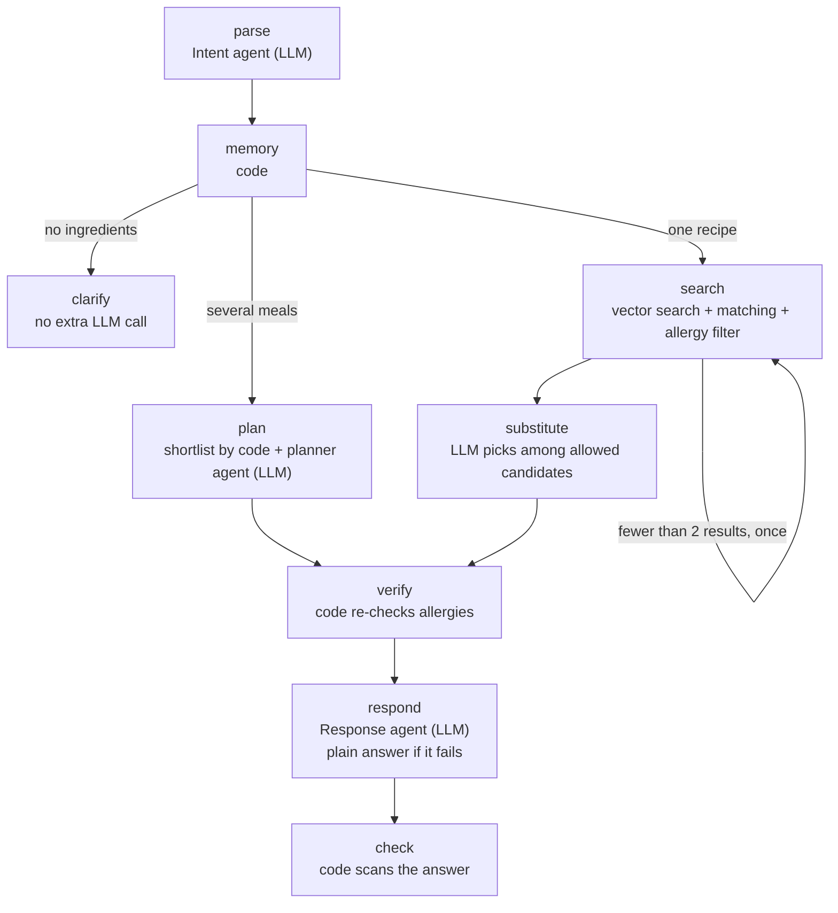

# Recipe Agent

An Arabic / English assistant that suggests recipes from the ingredients you have.
Built for the DEPI Generative & Agentic AI Development track.

Write something like *"عندي فراخ وأرز وثوم وعايزة أكلة تخلص في نص ساعة"* or
*"I have eggs, tomatoes and cheese. Under 20 minutes."* and get up to 3 recipes with
steps, time, servings, calories and protein per serving, what you already have, what is
missing, and a shopping list.

> **Not medical advice.** The allergy filter is a set of word lists plus checks, not a
> guarantee. Always read product labels. See [Known limitations](#known-limitations).

## What it does

- Finds recipes from your ingredients (semantic search over about 19.5k recipes, then
  ingredient matching and ranking by code).
- Understands Arabic (including Egyptian dialect) and English; the answer is written in your language.
- Respects allergies and avoided ingredients (milk, egg, peanut, tree nuts, wheat/gluten, soy,
  fish, shellfish, sesame, or any ingredient name).
- Suggests substitutions for missing ingredients, from a small hand-written table.
- Plans several meals at once (up to 5) with one combined shopping list.
- Can remember your allergies between conversations, only when you ask it to.
- Asks for ingredients when your message does not contain any.
- Works with a free Gemini API key, with a plain-text fallback answer when the model is unavailable.

## How it works



The LLM (Gemini) is used only where language understanding or writing is needed.
Searching, matching, ranking and allergy filtering are plain Python, so an allergy never
depends on what the model remembers. Whatever the LLM returns is validated by code:
substitutions and meal plans must come from candidate lists built by code, and anything else is dropped.

| Step | Done by | Notes |
|---|---|---|
| parse | LLM (structured output) | ingredients (English), exclusions, time limit, language, number of meals, remember/forget flags, optional clarifying question |
| memory | code | saves / clears / applies allergies, stored in a local JSON file |
| search | code | Chroma vector search, ingredient matching, allergy filter; widens the search once if fewer than 2 recipes are found (allergies are never relaxed) |
| plan | code + LLM | code builds a shortlist of 12; the LLM picks and orders; code drops invented or repeated picks |
| substitute | code + LLM | candidates come from a small table and are filtered by allergies; the LLM chooses; code validates |
| verify | code | re-checks the final recipes and substitutes against the allergies |
| respond | LLM | writes the answer; if the call fails, a plain answer is built from the data (steps stay in English) |
| check | code | scans the written answer for allergen words (English) and compares calories / minutes with the data |

A normal question uses about 2 to 3 LLM calls (parse, substitutions if any, answer). A clarifying
question uses 1.

### Data

Recipes come from the Kaggle dataset
[Food.com - Recipes and Reviews](https://www.kaggle.com/datasets/irkaal/foodcom-recipes-and-reviews)
(license shown on its page: CC0). `src/recipe_agent/ingest.py` prepares it:

- keeps recipes with at least 3 reviews and a rating of at least 4.0 (111,877 recipes);
- drops recipes whose ingredient list is shorter than their quantity list (49,731), because the
  list is incomplete (for example a chicken recipe without chicken);
- drops recipes with missing calories, servings, ingredients or steps, and duplicate names;
- decodes HTML entities, converts ISO durations to minutes, removes the quantities column
  (the dataset stores quantities without units);
- result: **19,554 recipes**.

Each recipe is embedded from its name, category, ingredient names and tags (not its steps) with
`paraphrase-multilingual-MiniLM-L12-v2` and stored in Chroma (cosine similarity).
Recipes are then ranked by: how many of your ingredients they use, fewest missing items,
coverage, and semantic distance.

## Setup

Tested only on **Google Colab (CPU, Python 3.13)** with the exact versions in `requirements.txt`.
The first install is large because `sentence-transformers` brings `torch`.

You need a Gemini API key from [Google AI Studio](https://aistudio.google.com/). Use your own key:
the free tier has small daily and per-minute limits (see below).

### Google Colab

1. Add your key in Colab: the key icon, then a secret named `GOOGLE_API_KEY`, with notebook access on.
2. Run these cells in order.

```python
!git clone https://github.com/Mennaali30/recipe-agent.git
%cd recipe-agent
%pip install -q -r requirements.txt
```

```python
# Build the data and the index (needs to be done once per session, unless you back them up)
import sys, kagglehub
sys.path.insert(0, "/content/recipe-agent/src")
from recipe_agent.ingest import run
from recipe_agent.retriever import build_index

path = kagglehub.dataset_download("irkaal/foodcom-recipes-and-reviews")
run(raw_dir=path)          # writes data/processed/recipes.parquet (about 19.5k recipes)
print(build_index())       # writes chroma_db/ (takes a few minutes on CPU)
```

If Kaggle asks you to log in, download `recipes.parquet` from the dataset page and pass its folder to `run(raw_dir=...)`.

Colab erases its disk when the session ends. To avoid rebuilding, copy `data/processed/recipes.parquet`
and a zip of `chroma_db/` to Google Drive and restore them in the next session.

```python
import os
from google.colab import userdata

os.environ["GOOGLE_API_KEY"] = userdata.get("GOOGLE_API_KEY")
os.environ["LLM_PROVIDER"] = "gemini"
os.environ["GEMINI_MODEL"] = "gemini-3.6-flash"
os.environ["GEMINI_FALLBACK_MODELS"] = "gemini-3.8-flash"
# Model names change over time: check the models page in Google AI Studio.

from recipe_agent import graph
print(graph.answer("عندي فراخ وأرز وثوم وعايزة أكلة تخلص في نص ساعة"))
```

Chat UI (Gradio):

```python
sys.path.insert(0, "/content/recipe-agent/app")
import gradio_app
gradio_app.demo.launch(share=True)
```

`share=True` creates a public link with no login. Everyone who has it uses your API quota and
shares the same saved allergies, so do not post it.

### Local machine (not tested)

```bash
python -m venv .venv && source .venv/bin/activate     # Windows: .venv\Scripts\activate
pip install -r requirements.txt
cp .env.example .env                                   # then put your key and model names in .env
python -c "import kagglehub; print(kagglehub.dataset_download('irkaal/foodcom-recipes-and-reviews'))"
python src/recipe_agent/ingest.py --raw-dir <folder printed above>      # run from the repo root
python -c "import sys; sys.path.insert(0, 'src'); from recipe_agent.retriever import build_index; print(build_index())"
python app/gradio_app.py
```

### Environment variables

| Variable | Meaning |
|---|---|
| `LLM_PROVIDER` | `gemini` (the only provider implemented) |
| `GOOGLE_API_KEY` | your Gemini API key |
| `GEMINI_MODEL` | primary model code |
| `GEMINI_FALLBACK_MODELS` | comma separated models tried in order when the primary one fails (quota, overload, timeout) |
| `RECIPE_MEMORY_PATH` | optional: where saved allergies are stored (default `data/memory/profiles.json`) |
| `RECIPE_CACHE_PATH` | optional: where cached answers are stored (default `data/cache/answers.json`) |

### Free-tier limits and the cache

On our account the free tier allowed 20 requests per day per model and 5 per minute, which is only
about 7 questions per day per model. Limits change, check yours in Google AI Studio. To reduce the
impact:

- an identical request (ignoring case, spaces and trailing punctuation, with the same saved
  allergies) is answered from a cache with no LLM call;
- `examples/answers_cache.json` ships saved answers for the example questions of the chat UI;
- if the model fails while writing the answer, you still get the recipes as a plain answer.

Understanding the request always needs the model, so a brand new question cannot be answered
when the quota is exhausted.

## Project structure

```
src/recipe_agent/
  config.py      LLM selection and fallback chain
  schemas.py     Pydantic models (request, substitution plan, meal plan)
  ingest.py      dataset cleaning
  retriever.py   Chroma index and semantic search
  tools.py       ingredient matching, allergy filter, substitutions, ranking
  agents.py      intent, substitution, meal planner and response agents
  graph.py       LangGraph workflow
  memory.py      saved allergies (JSON file)
  verifier.py    allergy re-check, answer check, plain fallback answer
  cache.py       answer cache
  evaluation.py  evaluation code
app/gradio_app.py      chat UI
examples/answers_cache.json   saved answers for the UI examples
```

## Evaluation

Measured during development with `src/recipe_agent/evaluation.py`. The test sets are small and written
by us, so read them as indications, not proof.

**Retrieval (20 ingredient sets, no LLM involved)**

| Measure | Result |
|---|---|
| at least 2 recipes returned | 95% |
| main ingredient in the first recipe | 90% |
| share of your ingredients used (average) | 89.9% |
| cases with a recipe that uses all your ingredients | 80% |
| time limit respected | 100% |

Known cases: tuna and rice in under 25 minutes returns nothing (the dataset has no such recipe), and
bread, egg and cheese returns egg and cheese recipes without the bread.

**Allergy filter audit (5,000 recipes, no LLM involved).** A second, wider word list is searched with a
different method (regex on the raw text) and compared with the filter.

| Allergen | recipes flagged by the audit | missed by the filter |
|---|---|---|
| milk | 3,417 | 0 |
| egg | 1,408 | 0 |
| peanut | 105 | 0 |
| tree nuts | 598 | 0 |
| wheat / gluten | 2,268 | 0 |
| soy | 240 | 0 |
| fish | 342 | 0 |
| shellfish | 159 | 0 |
| sesame | 73 | 0 |

The first run found misses (for example Worcestershire sauce, which contains anchovies, in 34% of the
fish recipes) and the filter lists were extended. **Both lists are ours and now overlap, so zero misses
means the filter implements our lists, not that every allergen source is covered.**
Hidden sources that are in neither list (for example chocolate that may contain milk) are not measured.
Canned soup used as an ingredient is caught by a heuristic: on the same sample it removed 9 of 1,583 recipes that
pass the milk filter (0.6%), and some of those may be false alarms.

**Intent agent (18 messages, uses the LLM).** 15 calls succeeded and all 15 were fully correct
(ingredients, exclusions, time limit, language). 3 calls failed because of quota or server overload,
so the figure counting failures is 83.3%. This was measured before the meal-plan, memory and
clarifying-question fields were added to the prompt and was not re-run.

We also ran a handful of real end-to-end questions with Gemini (single recipe, allergies, substitutions,
a 3-day plan, saving and clearing allergies). That is not a benchmark.

To re-run:

```python
from recipe_agent import evaluation as ev
df = ev.eval_retrieval();                 print(ev.summarize_retrieval(df))
df_all, leaks = ev.eval_allergy_audit();  print(df_all)
df_int = ev.eval_intent()                 # about 18 LLM calls, waits 13 s between calls for the free tier
```

## Known limitations

- **No quantities.** The dataset stores ingredient quantities without units, so the app does not show a
  quantities list. Quantities appear only inside the recipe steps. The meal planner cannot tell whether
  what you have is enough for several meals.
- **Ingredient lists can be incomplete or wrong.** We drop recipes whose list is shorter than their
  quantity list, but cannot detect every case. We saw a recipe where broccoli from the title was missing
  from the list, so "missing ingredients" can be wrong.
- **Allergy filter.** Word lists with allergen families (milk also removes cheese, butter, cream...),
  plus a scan of the recipe steps and a canned-soup heuristic. It is conservative (coconut milk is also
  excluded for a milk allergy), it misses sources that are not in the lists, and the check on the written answer
  looks only for English words. It is not a safety guarantee.
- **Recipes are user submitted.** Food.com recipes are not reviewed (we saw an unusual dishwasher-salmon
  recipe). Times and nutrition values are the dataset's, are approximate, and some look odd. We treat
  nutrition values as per serving, which we did not confirm in the dataset documentation.
- **Translation by the LLM can be wrong.** We saw misspelled words and awkward phrases. In the plain
  fallback answer the steps stay in English.
- **Matching is word based.** "Sweet potato" matches "potato", and "butter" can match "peanut butter".
- **Substitutions** come from a table of about 25 ingredients that was written by hand and not tested
  in real cooking. Ingredients not in the table get no substitute.
- **Saved allergies** are stored in a local JSON file. The chat UI has no login, so everyone who opens a
  public link shares one profile.
- **Not an autonomous agent.** The workflow is fixed in code. The LLM decides when to ask a question, which
  substitutes or meals to pick, and whether to save allergies, but it does not choose tools freely.
- **Tested only on Google Colab with Python 3.13.**

## Ideas for whoever continues

- re-run the intent evaluation and extend it with the new fields (meals, remember, forget);
- more saved example answers (read each one before committing, translations can have mistakes);
- another LLM provider in `config.py` for a separate quota;
- a dataset with ingredient quantities and units;
- a login or per-session id for the chat UI.

## License

See the `LICENSE` file.

## ملخص بالعربي

مساعد وصفات بالعربي والإنجليزي: بتكتبي المكونات اللي عندك (ويمكن وقت أو حساسية) فيرجعلك حتى 3 وصفات
بالخطوات والسعرات والمكونات الناقصة وقايمة تسوق، أو خطة وجبات لحد 5 أيام. البحث والمطابقة وفلتر الحساسية
بالكود، وGemini بيفهم الطلب ويكتب الرد بس.

للتشغيل على Colab: نفّذي خلايا قسم Setup بالترتيب، وحطي مفتاح Gemini بتاعك في Colab Secrets باسم
`GOOGLE_API_KEY`. الكوتا المجانية صغيرة، فكل واحد يستخدم مفتاحه.

أهم الحدود: الداتا من غير كميات ووحدات، وقوايم المكونات ممكن تبقى ناقصة، وفلتر الحساسية مش ضمان،
فراجعي ملصقات المنتجات دايماً. التفاصيل في قسم Known limitations.
